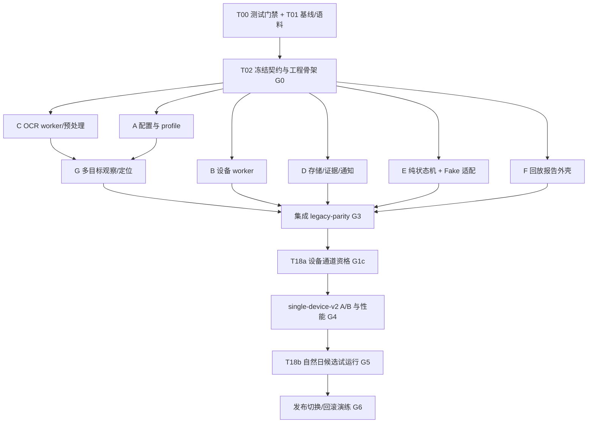

# 单台 Android 每日签到：Python 模块化重构总规划

版本：规划规格 v1.0，2026-11-05（Asia/Taipei）。状态：可用于拆任务；尚未实现、未跑手机、未部署。

本包的目的：让多个实现者按同一份契约并行开发，不各自重做设备连接、状态判断、OCR 配置或通知。难度不作为选型限制；正确性、单次任务墙钟时间、失败可诊断性和可回滚性是约束。

## 1. 阅读与执行顺序

1. 本文件：目标、选型、迁移边界和总阶段。
2. [架构与接口契约](architecture-contracts.md)：实施前冻结的模型、接口、状态转移和不变量。
3. [并行任务与交接规格](tasks.md)：任务 ID、依赖、独占写目录、完成标准、交接模板。
4. [行为、质量与性能验收](acceptance.md)：47 个既有用例、11 个负对照、真图基准、性能门槛、试运行和回滚。
5. [MaaFramework 专项评估](maaframework-evaluation.md)：用户追加参考后的正式后端候选、源码边界、接入任务与晋升规则。

规格冲突时：用户当前明确指示 > 已冻结的变更记录 > 接口契约 > 验收规格 > 任务描述。发现冲突先登记到 contracts/changes.md，由集成人裁决；实现者不能通过自行增补隐式行为解决冲突。

本包出现的 src/、tests/、contracts/、reports/、deploy/ 路径是计划产物，不代表现有代码已经具备。命令示例也属于未来接口，完成 T02 后才能执行。

## 2. 已核对的基线

- 仓库：takomitkm/pdd-dailycheck-AIGC。
- 本地提交：b59d150151b1d7ff59e33d9b766a4ead15c72b77；规划开始时 git status --short 为空。
- [现役主程序](../../pdd.sh)：2073 行，SHA-256 `8bd6e038fe28c46acfe82f09ce4ae9b25e8e979f559a41843e64bb944c760e90`。
- 现有设施：47 个桩沙箱场景、两种分辨率、11 个负对照、离线 replay、systemd 用户级定时器；工具侧另有 21 项验收记录。
- 设备/主机资料来自仓库与 Qoder 历史，不是本次重新探测：Debian 13，单台 ZTE Android，无线 ADB，日常点空间 720×1280。
- 本次已读 Qoder 原始会话 `c8236d0b-cdb5-4915-9701-b50daa9821b5`。早期目标是简洁、一个脚本或一个桌面文件夹；这次用户明确要求模块化和性能优先，采用一个可部署目录内的 Python 包。
- 不复制主机私有配置和凭据进规划或仓库。真正的 CPU 指令集、Python/库兼容性、设备端服务可用性和模型性能，在 T01/T03 采集。

### 已证实的结构问题

| 问题 | 证据 | 迁移动作 |
|---|---|---|
| XML 优先只是返回优先级；先付两档整页 OCR 成本 | [定位循环](../../pdd.sh#L813) | 识别按需执行、每档及时短路 |
| text_present 改全局重试数，bag=12 仍覆盖它 | [重试优先级](../../pdd.sh#L803)、[状态检查](../../pdd.sh#L1145) | 重试预算显式传参，嵌套调用继承截止时间 |
| done/exchange/pend/count 分别采集识别 | [点前检查](../../pdd.sh#L1556) | 一份观察结果同时判多个目标 |
| Python/Pillow 反复启动，裁片重复生成 | [band](../../pdd.sh#L877)、[pill](../../pdd.sh#L967) | 单次任务复用进程、解码结果和识别器 |
| OCR stderr 丢弃、TSV 未留，回放重算 | [OCR](../../pdd.sh#L825)、[回放限制](../../pdd.sh#L1717) | 原始识别、判断与动作均可追踪 |
| 沙箱失败数不决定进程退出码；外层管道可掩盖失败 | [沙箱末尾](../../sandbox/sbx.sh#L484)、[运行器](../../scripts/run-sandbox.sh#L32) | T00 先修门禁，禁止按成功字样判绿 |
| 负对照没咬住只打印；末尾仍可能成功 | [负对照运行器](../../scripts/negative-control.sh#L23) | 必须统计 executed/killed/survived，未执行也失败 |

这些是源码检查结论。现有离线测量显示整页 psm6 约 1.4～3.4 秒、整场约 4～5 秒/帧，见[原始口径](../api-attribution.md#L150)。不是本次在线性能占比，也不证明换 Python 会快几倍。

## 3. 已定架构与后端裁决

Python 业务状态机、单设备执行器、模块契约、systemd 调度现在确定。设备与 OCR 后端采用性能/质量门禁裁决；优先评估 Maa 原生底座，adbutils/U2 + RapidOCR 是对照与回退。尚未在本机证明谁更快，不提前锁死赢家。只保留一套业务流程和一个最终默认运行 profile。

| 层 | 选择 | 具体边界 |
|---|---|---|
| 主语言 | Python，目标运行时先选 Debian 13 的 Python 3.13 | T01 验证 wheel/CPU 支持；不支持时用 uv 管理兼容的受支持 Python 小版本，写 ADR，不改变模块接口 |
| 环境与构建 | uv + pyproject.toml + uv.lock + wheel | 部署用固定绝对路径 venv，不在定时任务里解析依赖、下载模型或运行 uv sync |
| 设备层 | 优先评估 Maa controller（Maatouch/无损截图）；对照 adbutils + 按需 U2 XML | 真正最优的输入/截图通道在T03-M/T18a分别比较；真实焦点、显式Activity和不重复动作由统一端口保障 |
| 主 OCR | 优先比较 Maa OCR 与 RapidOCR/ONNX Runtime CPU，小型中文/英文模型 | 每轮只初始化选中模型一次；T03/T03-M 按实际模型、冷启动、定位质量和错误语义裁决，不依赖上游可变默认 |
| 兼容/特例 OCR | 当前 Tesseract + chi_sim+eng + 已标定 recipe | 先逐字节/逐候选迁移；目标栈中作为按目标调用的兜底，不与主 OCR 每帧全量双跑 |
| 图像处理 | Pillow + OCR 依赖的 NumPy/OpenCV | 裁图、缩放、色彩、阈值和坐标映射均可独立回放；OpenCV 已随 OCR 依赖存在时复用 |
| 配置 | TOML + 标准库 tomllib + 显式校验 | 普通配置、标定 profile、私有端点文件分开；兼容旧 conf 的只读导入器 |
| CLI/类型 | argparse、dataclasses、Enum、Protocol；静态检查用 mypy | 不引入 Web 服务；CLI 只有一个组合根，业务模块不读全局环境 |
| 日志/报告 | logging/JSONL + 标准库 HTML 生成器 | 本地静态时间线与识别框图；无需仪表盘后台 |
| 测试 | pytest、Hypothesis、pytest-xdist、Ruff、mypy | xdist 仅用于隔离的离线测试；真机执行始终串行 |
| 调度 | 既有 systemd timer/service | 继续 10:00、0～180 秒抖动、Persistent；保留 home-lab 的依赖关系 |
| 通知 | 标准库 HTTP 客户端的薄适配器 | 保留 ServerChan、一次发送、无自动重试、失败不改变业务结果 |

### 为什么这样组合

- 单台每天一次，无需 Appium server、工作队列、数据库、Redis、Celery、常驻主机 Web 服务、浏览器或视觉大模型代理。
- MaaFramework 正式纳入设备/OCR底座候选；完整 Pipeline + Python hooks 也是可行路线，但首轮保留一个 Python 业务状态机，避免重复恢复编排。Maa 的ROI、稳定等待、回调和录放设计直接参考；不以游戏案例多、分辨率或没有内建XML为由排除它。详见 [专项评估](maaframework-evaluation.md)。Airtest/Poco不进入首轮候选。
- 选中的设备端辅助服务仅在运行期按需管理；主机无需为一次签到保持OCR常驻24小时。Maa输入通道初始化/推送手机端二进制同样计入每日冷启动成本。
- 对这台机器的最优CPU执行器必须实测。RapidOCR对照默认ORT CPU；T03可同模型比较OpenVINO CPU。Maa候选使用其受锁版本实际支持的执行器/线程参数，不能假定能配置所有RapidOCR参数。只有质量不下降且每日冷启动到完成更好才晋升。GPU不进入首版，主机尚无已验证GPU推理条件。
- Tesseract 兜底先保留 CLI 形式，确保 recipe 行为可对比。若它成为测得的主要瓶颈，再在同接口内比较 tesserocr 持久 API；不是本次切换前置条件，不创建第二套业务路径。

### 已查到的上游陷阱：实施时必须有测试

1. uiautomator2默认screenshot()会请求JPEG，保存成.png不能恢复无损。对照默认ADB screencap PNG；Maa允许无损raw→canonical PNG，必须记录transport/原始编码/像素hash，不把有损JPEG转PNG当无损。
2. adbutils 的 screenshot(error_ok=True) 可能用纯黑图替代采集错误。适配器不能使用此降级；原始 PNG 必须可完整解码，并保留错误。
3. uiautomator2 的 jsonrpc_call 在部分通信错误后会重启服务并重放原 RPC，点击也可能重发。因此首版所有变更设备状态的动作通过不自动重试的 adbutils 适配器执行；不调用 u2.click/swipe/press 等可隐式重放的快捷方法。
4. u2.app_current() 不等于当前窗口未被通知栏覆盖。必须保留真实焦点窗口状态；StatusBar/锁屏/未知不得由底层 PDD resumed activity 放行。
5. u2.app_start() 在没有明确 Activity 时存在 monkey 兜底。必须显式指定现有 HOME_ACT，启动后验证首页，不把恢复的旧订单页当首页。
6. u2 的 dump 内部有重试，隐式等待也有默认值；依赖测试须量出实际调用次数，设备 worker 总 deadline 必须能打断卡住的库。
7. RapidOCR实例调用可能改变内部参数。每个OCR worker独占实例，禁止多个线程同时用同实例跑不同recipe。
8. Maa截图有多层重连/重试、可能重启ADB server，OCR空结果可能混合推理错误；Record/Replay并不自动验证业务坐标。Maa候选必须补齐同一hard deadline、错误和动作合同，不能凭框架名称豁免。

上游依据（2026-11-05 阅读，链接为可变主分支；T03 必须记录安装版本和源提交）：
- [uiautomator2](https://github.com/openatx/uiautomator2)、[截图/启动实现](https://raw.githubusercontent.com/openatx/uiautomator2/master/uiautomator2/__init__.py)
- [uiautomator2 RPC 重放](https://raw.githubusercontent.com/openatx/uiautomator2/master/uiautomator2/core.py)
- [adbutils PNG 与错误降级](https://raw.githubusercontent.com/openatx/adbutils/master/adbutils/screenshot.py)
- [RapidOCR](https://github.com/RapidAI/RapidOCR)、[配置项](https://raw.githubusercontent.com/RapidAI/RapidOCR/main/python/rapidocr/config.yaml)

## 4. 两种运行 profile，分开验收

### legacy-parity

用于证明模块化没有丢掉既有行为。按原 XML → psm11 → psm6 → band → pill → 允许的坐标兜底顺序；保持候选选择、别名、区域、步数、通知、标记和账本规则。执行改为真正懒加载，状态检查单次预算修复须以 D01 显式登记。

不是把 Bash 的全局变量和临时文件名原样重建；保留的是外部行为与判据。已识别的源码/文档矛盾，按 acceptance.md 的 B 表留档，不能由某个模块作者擅自“修正”。

### single-device-v2

最终目标。按页面/目标配置路由：有可用节点时先 XML；活动页先本地轻量 OCR/已标定 ROI；同一帧多目标共享识别；Tesseract 仅对难例目标兜底。保持用户既定业务规则，包括兑换必须人工处理、“已使用”沿用当前语义、不更换通知端点。

RapidOCR/设备后端切换、候选粒度变化及固定等待缩减均有单独 A/B 报告。主 profile 没达到质量和性能门槛时，继续优化该实现；不因“重构已完成”就强行切生产。

## 5. 最终目录与模块归属

```text
pyproject.toml, uv.lock                     # 集成人维护
contracts/                                 # 公共 schema、baseline、变更记录
  behavior-v1.json
  contracts-v1.json
  changes.md
src/pddcheck/
  domain/                                  # 类型、坐标、纯模型、时钟契约
  config/                                  # TOML/旧 conf/profile 装载
  device/                                  # 独占设备 worker、ADB/U2 适配
  vision/                                  # OCR worker、预处理、引擎适配
  perception/                              # XML/OCR 匹配、多目标观察、页面事实
  workflow/                                # 纯转移函数、执行编排、重试预算
  storage/                                 # 运行锁、标记、账本、原子落盘
  evidence/                                # 原始工件、事件、计时
  notify/                                  # 标题正文、单次 HTTP、脱敏
  replay/                                  # 精确回放、重识别、HTML 报告
  cli/                                     # 组合根与命令兼容
  __main__.py
profiles/pdd/v1/                            # 公共别名/ROI/recipe，不含账号资料
models/manifest.json                       # 名称、版本、SHA、许可证；权重不直接进 git
resources/                                 # 静态报告资源
scripts/                                   # 既有 Shell 部署 + 新验证入口
systemd/                                   # 保留现有定时规则，增候选模板
legacy/                                    # 固定基线副本及说明，不复制端点配置
tests/                                     # 隔离测试与固定夹具
  domain/, config/, device/, vision/, perception/, workflow/
  storage/, evidence/, notify/, replay/, cli/, integration/
  fixtures/public/, fixtures/private-index/
bench/                                     # 固定数据集测量与基准协议
reports/                                   # 被 gitignore 的生成结果
```

所有设备动作经过 DeviceBroker。流程不能直接 import adbutils/uiautomator2；识别不能点击；通知不能改结果；回放不能构造真设备。具体接口见 architecture-contracts.md。

## 6. 分阶段与并行依赖



- 阶段 0：修测试门禁、保存基线、建立固定语料。独立测试门禁分支和语料分支可以并行，合并后才能信任 G0。
- 阶段 1：冻结公共类型和错误/日志 schema；之后 A～F 六条线可并行。
- 阶段 2：整合定位、流程和 CLI，旧 Tesseract profile 先过行为门禁。
- 阶段3：先T18a/G1c设备通道资格，再对Maa/RapidOCR、页面路由、截止时间与缓存逐项测量，G4裁决默认后端；不增加签到业务动作。
- 阶段4：T18b/G5自然日单执行器试运行、发布、回滚演练。手机不会给多个开发者同时测试。

任务完成取决于验收，不按预计天数。没有可用真图、相应终态未出现、设备测试未做，必须标为“缺证据/待验证”，不能记成通过。

## 7. 性能原则与目标

### 必须实现的结构约束

- 一次任务每个模型只加载一次；最多一个设备 worker 和一个在线 OCR worker。
- 一次观察的同一图像/recipe/引擎版本最多计算一次。对多个别名复用候选，不为每个 key 重新 OCR。
- XML 已合法命中时不运行无用 OCR；截图仍可为审计采集一次，不等于必须识别。
- 对确实无有用节点的活动页，页面 profile 直接选择视觉，不每一轮都 dump XML。
- crop/resize 每个唯一 recipe 一次；必要识别才运行；在线不把所有 OCR 通道并行争抢 CPU。
- 设备读写调用串行，离线独立帧可并行。线程数 1/2/4 实测，禁止默认占满整机。
- 所有等待由 monotonic deadline 管理；嵌套重试不重置上级预算。固定浏览时长、20 次滑动及动作间隔首轮保留。
- 日志、原始输出和动作意图不能为追求速度省掉；可视化排版在任务结束后生成。

### 设计预算（不是已测成绩）

单观察热路径p95≤1.5秒；模型冷加载目标≤5秒；固定真实场次的离线端到端相对Shell基线至少改善30%，无质量下降，这是G4硬门槛。在线无恢复整轮目标≤120秒，轮播/恢复路径目标≤240秒，总deadline初值600秒；自然日样本少时逐日列账，不用几天数据宣称在线p95。以acceptance.md分层门槛为准。

这些数字是验收目标。CPU、无线 ADB、页面和模型尚未实测，T03/T16 用分项报告确定瓶颈；未达到目标就继续优化/调整可执行器，不编造速度保证，也不通过删掉浏览/核实步骤达标。

## 8. 第一批执行动作

按tasks.md开始：T00与T01并行；T02在基线可核实后冻结接口。T03/T03-M先做运行环境与离线引擎测量；首次安装/启动U2/Maatouch等手机端服务归T18a/G1c，结果先于G4最终后端选择，不混进离线检查。

集成人先建立行为变更记录、任务看板和 worktree，再按各任务的独占目录分配。不得让所有人同时修改原 pdd.sh 或公共 domain 类型。

交付完成时必须能回答：这次失败卡在哪页、原图是哪张、程序当时认到了什么、为何拒绝候选、每层花了多久、是否可能已经点过、如何离线重现。做到这些，再用性能门禁判断它是否比当前程序更适合单台每日签到。
